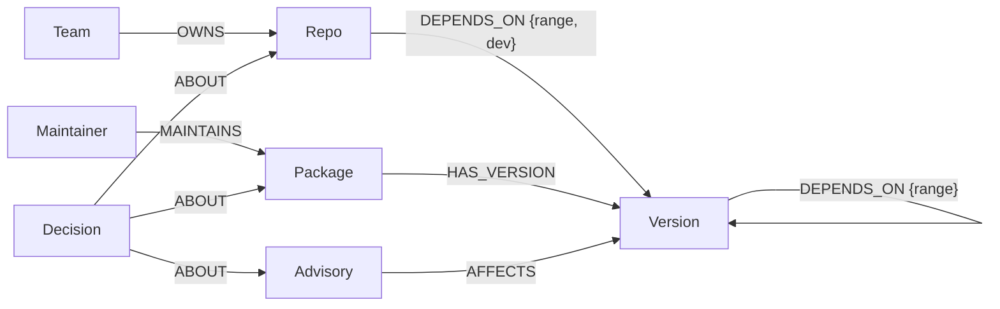

# Supply-chain blast radius

**A maintainer gets phished. Which of your repos are hit, through which dependency path, and who has to fix it?**
An agent that answers from a FalkorDB graph of your real, installed dependency trees, and shows the path behind every answer.

> Demo video: TODO · Live demo: TODO · Blog post: TODO
> Built for [Graph Hacks: Context for AI Agents](https://www.wemakedevs.org/hackathons/falkordb) (FalkorDB × WeMakeDevs).

## Why this needs a graph

On Sep 8, 2025, attackers phished one npm maintainer and published malicious releases of 18 packages,
including `chalk` and `debug` (about 2.6B weekly downloads combined). Most projects never declare
those packages themselves: they arrive several hops down the tree. Grepping every `package.json`
answers "who declares it?". The question that matters is "who installs it?", and that is a
multi-hop traversal.

| Question (17 real repos) | Depth 1 (grep) | Graph (any depth) |
|---|---|---|
| Who installs `debug`? | 1 repo (`playwright`) | **all 17 repos**, in 28 ms |

## Demo storyline (real output from `scripts/demo.py`)

1. **Grep vs graph:** only `playwright` declares `debug`, but the graph shows all 17 repos install it, for example `vscode -> eslint@10.8.0 -> debug@4.4.3`.
2. **Sep 8, 2025 hijack (`MAL-2025-46974`, `debug@4.4.2`):** no lockfile pins the bad release, and the agent says `not_in_graph`, not "safe". Then `fresh_install_exposure` finds 217 semver ranges that accept `4.4.2`: a lockfile refresh would have pulled it into all 17 repos.
3. **Phished account:** if npm user `qix` were compromised, 7 packages they publish reach all 17 repos (65 ms).
4. **Next xz:** single-maintainer packages ranked by PageRank, e.g. `postcss` (13 repos), `js-tokens` (16 repos).
5. **Act and remember:** record the decision as a dated node, recall it on the next question, and draft an issue for the owning team.

## What the agent can do

- **Blast radius** of a package, an advisory (GHSA / CVE / MAL id) or a hijacked maintainer account, at any depth, with the exact chain per repo.
- **Fresh-install exposure:** would a lockfile refresh pull a bad release? It checks the semver range stored on each dependency edge.
- **Where is our next xz?** Ranks the most depended-on packages that only one npm account can publish (PageRank).
- **Memory:** triage decisions are dated `Decision` nodes linked to the repo, package or advisory, and come back with later answers.
- **Act:** suggests an npm `overrides` fix and opens an issue for the owning team (drafted to `outbox/` unless a sandbox repo is configured).

## Tracks entered

- Track 01: Agents That Act on Connected Data (primary)
- Track 02: Agent Memory and Coordination (TODO: decide before submitting)

## Architecture

```
public lockfiles (GitHub) ─┐                                                                   ┌─ web agent (agent.py) ◄─ chat UI
OSV.dev advisories ────────┼─► blast-ingest ─► FalkorDB ◄─ queries.py ◄─ tools.py ◄─ MCP server ◄─┤    Claude, in-process MCP client
npm registry maintainers ──┘                   (graph)     (all Cypher)  (13 tools)                └─ any MCP client over stdio
                                                                                                       (Claude Code, Claude Desktop)
```

**The web agent** ([`agent.py`](src/blastradius/agent.py)) is an MCP client of the same server external clients use. It runs a streaming tool-use loop on `claude-opus-5-5`: adaptive thinking, effort `medium` (`BLAST_EFFORT`), prompt caching, append-only history, and server-side refusal fallbacks (`fallbacks: "default"`). Each step streams to the browser as newline-delimited JSON. The UI ([`web/`](src/blastradius/web/)) draws the dependency paths from the **tool results**, not from the model's text, beside each answer. So the evidence panel shows exactly what the graph returned.

Design rules:

1. **The model never writes Cypher.** It picks one of 13 tools. Each tool runs a fixed, parameterised query from [`queries.py`](src/blastradius/queries.py).
2. **Names are resolved against the graph first.** An unknown package, repo, maintainer or advisory returns `unknown_*` with suggestions, and no traversal runs.
3. **Every answer carries its path.** For example `pdf.js -> eslint-plugin-prettier@5.5.6 -> eslint@9.39.5 -> chalk@4.1.2`.
4. **Honest outcomes:** `answered`, `not_in_graph` ("no modelled path", never "safe"), `unknown_*`, `answered_from_memory`.

## Graph data model



| Label | Key | Properties | Source |
|---|---|---|---|
| `Repo` | `name` | `url` | `data/repos.json` |
| `Package` | `name` | | lockfiles |
| `Version` | `id` (`name@version`) | `name`, `version` | lockfiles (resolved with Node's lookup rules) |
| `Maintainer` | `name` | npm username only, no emails | npm registry |
| `Advisory` | `id` | `summary`, `severity`, `aliases`, `fixed`, `url` | OSV.dev |
| `Team` | `name` | `oncall`, `channel` | synthetic |
| `Decision` | `id` | `text`, `by`, `status`, `at` | written by the agent |

Current graph: 17 repos, 6,637 packages, 11,179 versions, 33,233 `DEPENDS_ON` edges, 357 advisories on 731 installed versions, 4,099 maintainers. Full ingest takes about 3 minutes the first time.

## Cypher and graph algorithms the product depends on

All queries live in [`src/blastradius/queries.py`](src/blastradius/queries.py). The core ones:

```cypher
// blast_radius: the shortest chain from every repo to any installed version of a package
MATCH (:Package {name: $name})-[:HAS_VERSION]->(v:Version)
MATCH (r:Repo)
WITH r, v, shortestPath((r)-[:DEPENDS_ON*]->(v)) AS p
WHERE p IS NOT NULL
WITH r, v, p ORDER BY length(p)
WITH r, collect(v.version) AS versions, collect(p)[0] AS p
RETURN r.name AS repo, length(p) AS depth, [n IN nodes(p) | coalesce(n.id, n.name)] AS path, versions
```

```cypher
// maintainer_blast_radius: everything a hijacked npm account can publish into
MATCH (:Maintainer {name: $name})-[:MAINTAINS]->(pkg:Package)-[:HAS_VERSION]->(v:Version)
MATCH (r:Repo)
WITH r, pkg, v, shortestPath((r)-[:DEPENDS_ON*]->(v)) AS p
WHERE p IS NOT NULL
...
```

```cypher
// dependency_paths: all equally short chains (FalkorDB algo.SPpaths).
// shortestPath first skips unreachable versions and caps maxLen, so SPpaths never enumerates the whole tree.
WITH r, v, shortestPath((r)-[:DEPENDS_ON*]->(v)) AS sp
WHERE sp IS NOT NULL
CALL algo.SPpaths({sourceNode: r, targetNode: v, relTypes: ['DEPENDS_ON'],
                   weightProp: 'weight', maxLen: length(sp), pathCount: $limit})
YIELD path, pathWeight
```

```cypher
// load_bearing_packages: PageRank over the dependency graph, filtered to single-maintainer packages
CALL algo.pageRank('Version', 'DEPENDS_ON') YIELD node, score
MATCH (pkg:Package)-[:HAS_VERSION]->(node)
WITH pkg, sum(score) AS rank
MATCH (m:Maintainer)-[:MAINTAINS]->(pkg)
WITH pkg, rank, collect(m.name) AS maintainers
WHERE size(maintainers) <= $max_maintainers
RETURN pkg.name AS package, rank, maintainers ORDER BY rank DESC LIMIT $limit
```

## Tool catalogue (MCP)

| Tool | Answers | Writes? |
|---|---|---|
| `find_package` | Is this package in our graph: versions, maintainers, advisories | |
| `direct_dependents` | Depth 1 only: who declares it (the grep answer) | |
| `blast_radius` | Who installs it at any depth, with paths | |
| `maintainer_blast_radius` | What a hijacked npm account could reach | |
| `fresh_install_exposure` | Would a lockfile refresh pull `pkg@version`? | |
| `advisory_impact` | Repos hit by a GHSA / CVE / MAL advisory, plus an `overrides` fix | |
| `repo_advisories` | Worst advisories reaching one repo | |
| `dependency_paths` | Every shortest chain repo → package (`algo.SPpaths`) | |
| `load_bearing_packages` | Single-maintainer packages ranked by PageRank | |
| `who_owns` | Team, on-call, channel | |
| `recall` | Past decisions, newest first | |
| `record_decision` | Save a dated decision linked to an entity | yes |
| `open_issue` | Issue for the owning team (sandbox repo or `outbox/`) | yes |

## Run it locally

Requires [uv](https://docs.astral.sh/uv/) and Docker (or skip Docker and use embedded FalkorDBLite).

```bash
docker compose up -d                 # FalkorDB on :6379, FalkorDB Browser on http://localhost:3000
cp .env.example .env
uv sync
uv run blast-ingest --reset          # ~3 min the first time (mostly npm maintainers), then cached
uv run python scripts/demo.py        # the demo storyline, read-only
uv run python scripts/demo.py --act  # also records a decision and drafts an issue
uv run blast-web                     # chat UI on http://localhost:8000 (needs ANTHROPIC_API_KEY in .env)
```

No Docker? Use the embedded engine (Python 3.12+):

```bash
uv sync --extra lite
echo "FALKORDB_LITE_PATH=.falkordb/lite.db" >> .env
```

Connect an agent over MCP (Claude Code shown; any MCP client works):

```bash
claude mcp add blast-radius -- uv run --directory "$PWD" blast-mcp
```

## Data sources

- **Lockfiles:** public `package-lock.json` files from 17 open-source repos (`data/repos.json`), fetched once and cached in `data/cache/`. Pin `ref` per repo for a reproducible demo.
- **Advisories:** [OSV.dev](https://osv.dev) (GHSA and OpenSSF malicious-package `MAL-` entries).
- **Maintainers:** public npm registry metadata. Only usernames are stored.
- **Teams and on-call:** synthetic. The demo treats these repos as one fictional company's services.

## AI assistance

TODO (required by the rules): name the coding assistants used and what the team wrote, reviewed and changed by hand.

## Before submitting

- [x] Agent loop and UI: chat on the left, the hop-by-hop path rendered on the right
- [ ] Run the chat once with a real `ANTHROPIC_API_KEY` and tune the system prompt in `agent.py`
- [ ] Deploy (FalkorDB Cloud + any host) or keep the local setup above
- [ ] 2-minute demo video following `scripts/demo.py`
- [ ] Blog post (separate prize)
- [ ] One graph per tenant (FalkorDB multigraph) if entering Track 02
